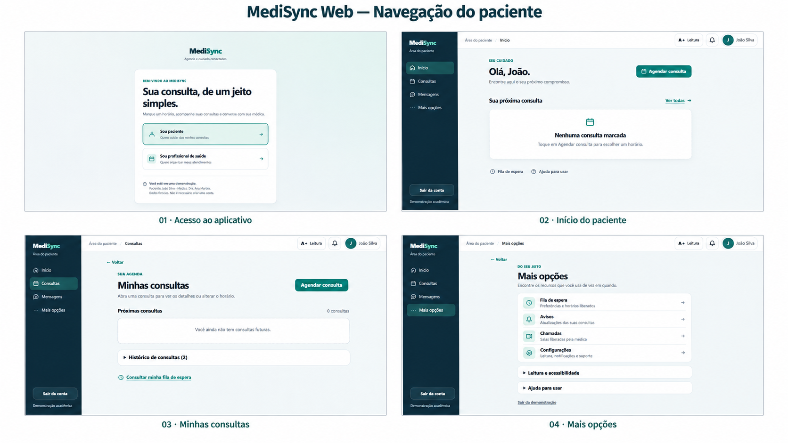
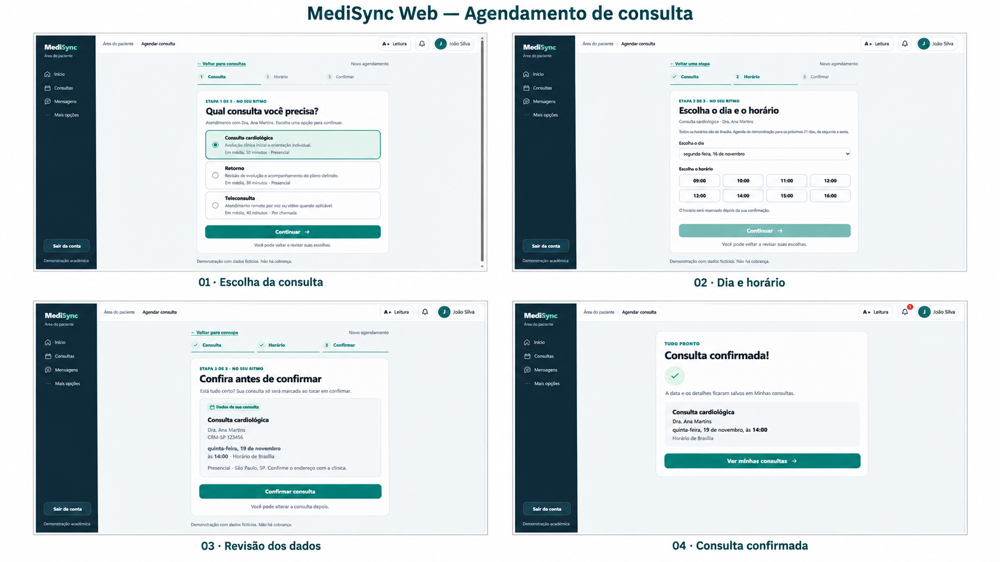
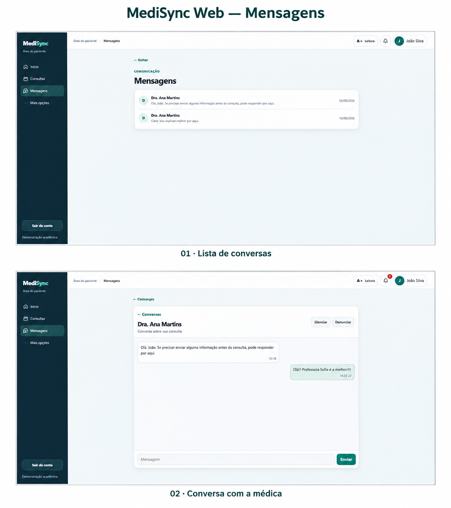
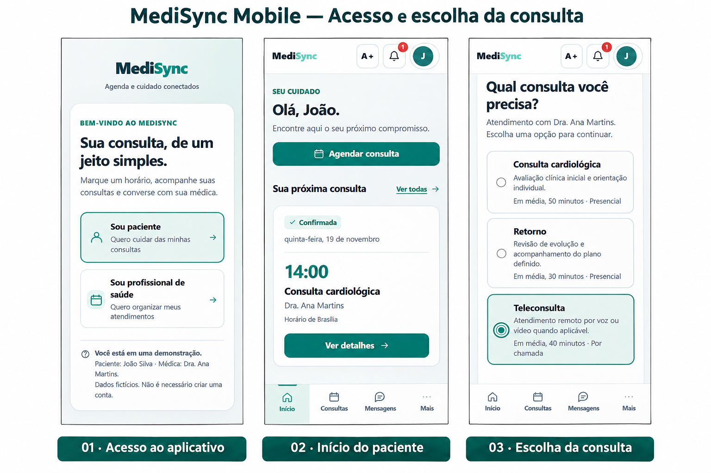
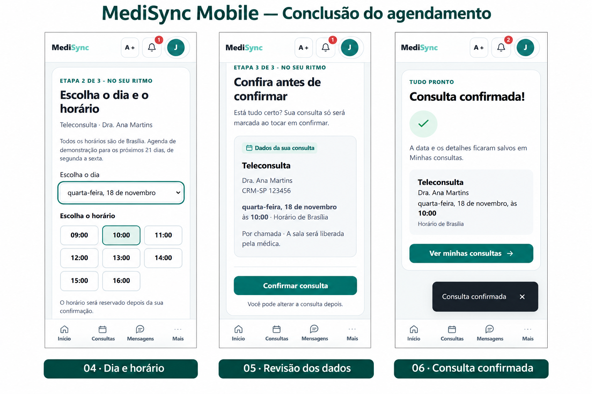

# Documentos e anexos

Materiais reunidos na revisão de entrega de 15/11/2026. Capturas e pranchas registram a interface em **13/11/2026**, antes da última revisão de privacidade. A aplicação atual usa credenciais explicitamente fictícias, cadastro minimizado e chamadas simuladas.

## Planejamento e apresentação

| Material | Uso e contexto |
| --- | --- |
| [Plano de marketing com anexos](https://github.com/fatecrl-ite004/MediSync/blob/main/docs/Plano-de-Marketing-MediSync-com-Anexos.docx) | Documento mais recente recebido, com anexos A–I e cinco pranchas web/mobile |
| [Documento recebido em 13/11](https://github.com/fatecrl-ite004/MediSync/blob/main/docs/historico/Plano-de-Marketing-MediSync-20261113.docx) | Fonte anterior à inclusão das cinco pranchas |
| [Transcrição Markdown revisada](https://github.com/fatecrl-ite004/MediSync/blob/main/docs/PLANO-DE-MARKETING.md) | Base de 31/10, revisada em 14/11 para retirar identificador empresarial não confirmado e alegação sem fonte; não substitui a edição Word de novembro |
| [Apresentação P1 Premium](https://github.com/fatecrl-ite004/MediSync/blob/main/docs/historico/MediSync-Apresentacao-P1-Premium-1.pptx) | Fonte histórica da proposta documentada na wiki |
| [Apresentação P1 Premium anterior](https://github.com/fatecrl-ite004/MediSync/blob/main/docs/historico/MediSync-Apresentacao-P1-Premium.pptx) | Variação histórica recebida |
| [Apresentação P1 inicial](https://github.com/fatecrl-ite004/MediSync/blob/main/docs/historico/MediSync-Apresentacao-P1.pptx) | Primeira apresentação disponível |
| [Modelo inicial de dados](https://github.com/fatecrl-ite004/MediSync/blob/main/MER/MER.jpeg) | Planejamento; a implementação atual usa JSON |
| [Histórico de protótipos](https://github.com/fatecrl-ite004/MediSync/tree/main/docs/historico) | Wireframes e pacotes antigos, preservados como referência; executar a versão atual na raiz |

> Os documentos históricos preservam as afirmações e exemplos do material recebido. Referências a empresa, CNPJ, CRM, experiências profissionais, preços e resultados não comprovam existência empresarial, credenciais verificadas, funcionalidade implementada ou resultado medido. A [revisão atual](https://github.com/fatecrl-ite004/MediSync/wiki/Privacidade-e-acessibilidade) é a referência para limites de uso. Não usar o material histórico como publicidade aprovada.

## Pranchas web e mobile

As pranchas foram montadas a partir das capturas fornecidas, com apoio de geração de imagem. Servem para apresentação; as **capturas originais** são a fonte para observar detalhes exatos da interface. Todas representam dados de demonstração, não pacientes ou atendimentos reais.

### Web: acesso e navegação

### Web: etapas do agendamento

### Web: mensagens

### Mobile: acesso e escolha da consulta

### Mobile: horário e confirmação

## Capturas originais

[Abrir as 16 capturas originais](https://github.com/fatecrl-ite004/MediSync/tree/main/docs/anexos/capturas-originais).

| Conjunto | Conteúdo |
| --- | --- |
| Web — 10 imagens | Acesso, início, consultas, mensagens, mais opções, três etapas de agendamento, sucesso e conversa |
| Mobile — 6 imagens | Acesso, início, escolha da consulta, horário, revisão e confirmação |

Origem dos ativos, licenças e confirmações ainda necessárias: [ATIVOS-E-LICENCAS.md](https://github.com/fatecrl-ite004/MediSync/blob/main/docs/ATIVOS-E-LICENCAS.md). Os anexos não substituem testes em dispositivos físicos ou com usuários.
