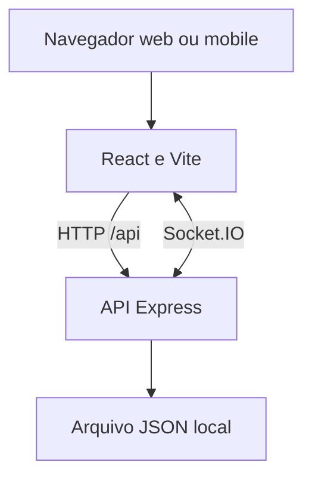

# Arquitetura e modelos

Revisão: 15/11/2026. Componentes existentes do protótipo:

| Camada | Implementação atual |
| --- | --- |
| Interface | React 18, TypeScript, CSS responsivo e Vite 6 |
| API e tempo real | Node.js 24, Express 4 e Socket.IO 4 |
| Persistência | `backend/data/medisync.json`, criado automaticamente |
| Identidade | Perfis demonstrativos; não equivalem a autenticação/autorização de produção |
| Comunicação | Mensagens vinculadas à consulta; chamadas somente simuladas |
| Banco definitivo | PostgreSQL planejado, sem migração ou integração nesta versão |

## Modelo inicial de dados

[Abrir o arquivo original do MER](https://github.com/fatecrl-ite004/MediSync/blob/main/MER/MER.jpeg).

O MER é um artefato de planejamento, não um esquema implementado. A API atual mantém também mensagens, registros de atendimento, salas simuladas, notificações, preferências, avaliações de teste, feedbacks e fila de espera em JSON. É necessário reconciliar o diagrama com essas entidades antes da migração.

## Regras principais

- Horários futuros e duração entre 10 e 240 minutos; bloqueio de sobreposição de consultas.
- Estados demonstrativos: confirmada, em atendimento, concluída e cancelada.
- O resumo deve ser salvo antes da conclusão e fica disponível para leitura após o encerramento.
- A fila de espera avisa sobre uma vaga compatível; não cria reserva exclusiva.
- Dados de demonstração não têm criptografia, segregação ou política completa de retenção. O arquivo não deve ser compartilhado entre instâncias simultâneas.

As decisões de navegação estão em [Experiência do usuário](https://github.com/fatecrl-ite004/MediSync/blob/main/docs/EXPERIENCIA-DO-USUARIO.md) e [Simplificação no PC](https://github.com/fatecrl-ite004/MediSync/blob/main/docs/SIMPLICIDADE-NO-PC.md). A proposta anterior está preservada em [Diferenciais, Arquitetura e Evolução do Sistema](Diferenciais,-Arquitetura-e-Evolução-do-Sistema).
